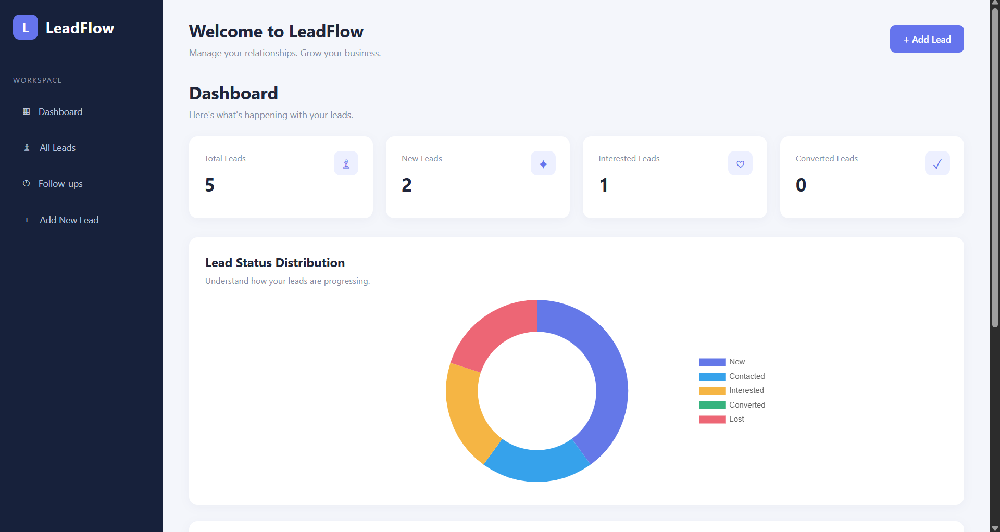
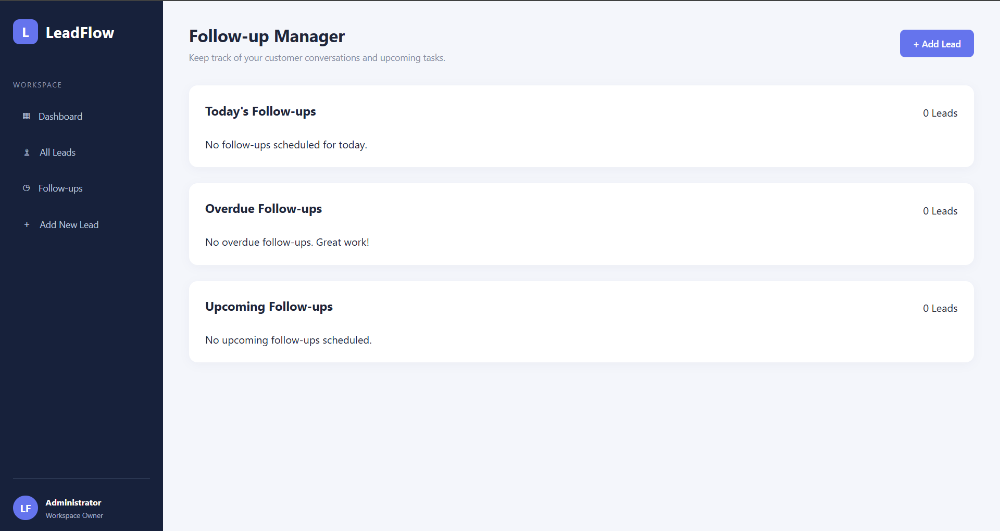

# LeadFlow CRM

A web-based Customer Relationship Management (CRM) application built using Python and Flask to manage customer leads, track sales progress, and organise follow-up activities.

## Features

* Dashboard with live lead statistics.
* Add, view, edit, and delete customer leads.
* Search leads by name, email, phone number, and company.
* Filter leads by status and source.
* Follow-up manager to track today's, overdue, and upcoming follow-ups.
* Interactive doughnut chart showing lead status distribution.
* SQLite database for persistent data storage.

## Technologies Used

* Python
* Flask
* SQLite
* HTML
* CSS
* JavaScript
* Chart.js

## Installation and Setup

1. Clone this repository:

   bash
   git clone YOUR_GITHUB_REPOSITORY_URL
   

2. Navigate to the project folder:

   bash
   cd LeadFlow-CRM
   

3. Create a virtual environment:

   bash
   python -m venv .venv
   

4. Activate the virtual environment on Windows:

    bash
   .venv\Scripts\activate
   

5. Install dependencies:

   bash
   pip install -r requirements.txt
   

6. Run the application:

   bash
   python app.py
   

7. Open your browser and visit:

   text
   http://127.0.0.1:5000

## Project Purpose

LeadFlow CRM was developed as a practical project to explore web application development, database management, customer relationship management, and sales pipeline tracking.

---

**Developed as a portfolio project.**
## Application Preview

### Dashboard

### Lead Management

### Add New Lead

### Follow-up Management

